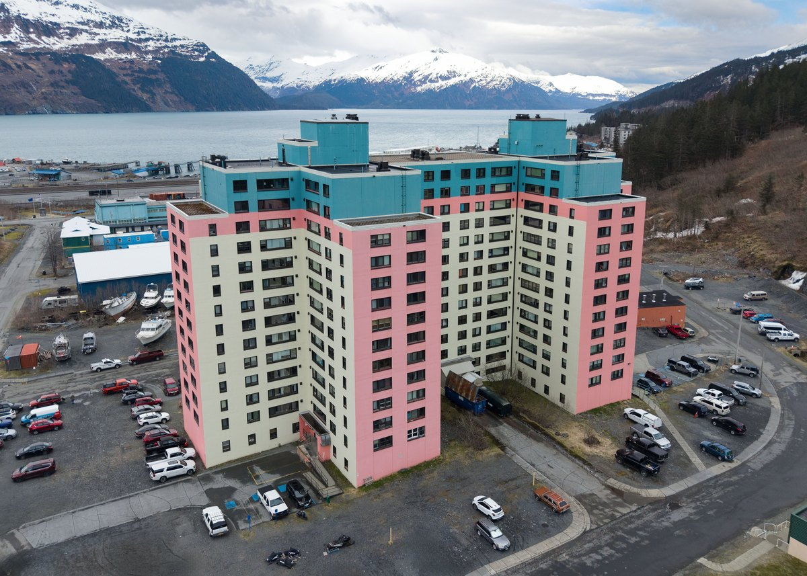

**市の2020年計画が描くのは、一棟に全員が住む町ではなく、大きな集合住宅に住まいと仕事の一部が集まる町です。** アラスカ州ウィッティアのベギッチ・タワーズ。その歩みをたどると、印象的な「一棟の町」というイメージにも、少し奥行きが出てきます。

## もとは軍の住宅だった

写真: [Quintin Soloviev / Wikimedia Commons](https://commons.wikimedia.org/wiki/File:Begich_Towers_Condominium_(Whittier,_Alaska).jpg)、[CC BY 4.0](https://creativecommons.org/licenses/by/4.0/)。2026年5月16日撮影。原版から縦横比を維持して縮小・JPEG再圧縮。切り抜き・描き足しなし。

ベギッチ・タワーズは、かつて「ホッジ・ビルディング」と呼ばれました。アラスカ州の建築史資料によると、1950年代に陸軍工兵隊が家族用住宅と独身士官の宿舎として建てた建物です。市への譲渡を経て、1974年にベギッチ・タワーズに改名。分譲集合住宅の組合も作られました。

## 住まいと町の機能が近い

市の2020年総合計画では、ベギッチ・タワーズに住宅以外の用途もあり、地元の事業者やサービス提供者が建物内の区画を使うと説明しています。大きな住宅棟がそのまま生活の場であり、町の機能の一部を担う場所にもなったのです。

一方、同じ市の計画は別の住宅としてウィッティア・マナーやアンカー・アネックスも挙げています。学校はタワーズの**南にある別の建物**です。商業施設もタワーズ内だけでなく、市街地や港近くの区域に分布します。

アラスカの港をイメージした参考イラスト（AI生成）。実際のウィッティアの施設や配置を再現したものではありません。

表紙写真：[Quintin Soloviev / Wikimedia Commons](https://commons.wikimedia.org/wiki/File:Whittier,_Alaska_aerial_view_2026.jpg)、[CC BY 4.0](https://creativecommons.org/licenses/by/4.0/)。2026年5月16日撮影。全体を縮小してWebPに変換し、記事一覧では表示枠に合わせて一部が切り取られます。施設の用途や入居状況は写真だけでは分かりません。

「一つの建物に町がある」という言葉は印象的。でも、**歴史ある大きな集合住宅が、周囲の建物や地区と一緒に町をつくってきた**と捉えると、少し違う景色が見えてきます。
