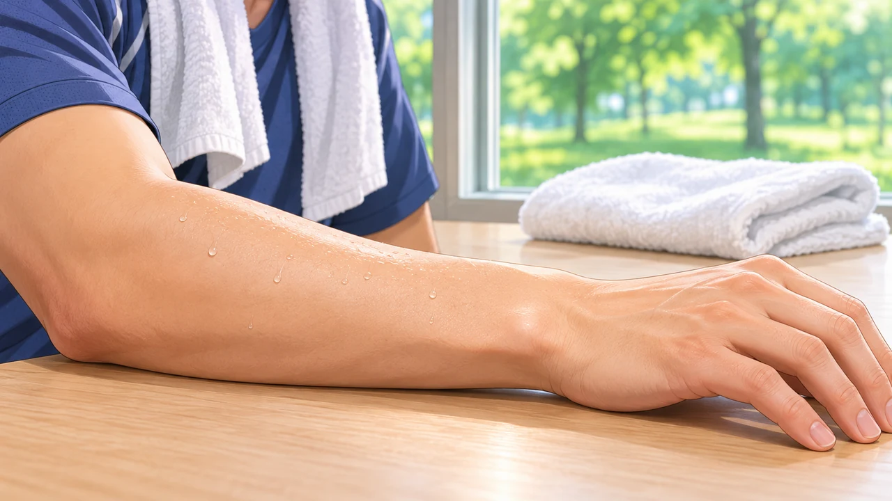

**汗がしょっぱいのは、食塩をつくる成分であるナトリウムや塩化物が、水に溶けて含まれているからです。** ただし、体の中の塩分が、そのままの濃さで外へ出ているわけではありません。汗が皮膚に届く途中で、一部は体へ戻されています。

汗は水を出すだけのしくみではなく、塩分を回収しながら働くしくみでもある。ここを知ると、「汗の濃さはいつも同じ？」という疑問の答えも見えてきます。

## 汗には、つくる場所と通り道がある

暑いときの体温調節に関わるのは、主に**エクリン腺**という汗腺です。皮膚の中にある、くるりと巻いた部分で汗のもとをつくり、細い管を通して表面へ送ります。

この通り道が、ただの排水管ではありません。管の壁でナトリウムや塩化物の一部が再吸収されるため、最初につくられた汗より、皮膚に出る汗のほうが薄くなるのです。

「再吸収」は難しそうな言葉ですが、いったん汗の側へ出した成分を、通り道で取り戻すこと。全部を回収するわけではないので、出てきた汗にも塩分は残ります。

## 汗が速く出ると、濃さも変わる

では、たくさん汗をかくときも、同じように回収できるのでしょうか。

暑い室内で運動の強さを変え、前腕の汗を調べた10人の研究では、汗が出る速さが上がるほど、汗のナトリウム濃度も高くなる関係が見られました。

面白いのは、**回収する働きが止まったわけではない**ことです。調べた範囲では、ナトリウムを汗へ出す速さも、回収する速さも上がっていました。ただ、出す側の増え方がより大きく、回収されずに残る分が増えた、と研究者は説明しています。

つまり、「汗が増えると回収がゼロになる」ではなく、出す働きと戻す働きのバランスが変わる、ということです。これは一定の条件で前腕の汗を測った結果で、どの人のどの場面でも同じ濃さになるという意味ではありません。

## 暑さに慣れたあとは、同じ速さでも違う

別の研究では、健康な男性8人が暑い環境での運動を10日間繰り返した前後を比べています。その結果、**汗が出る速さをそろえて比べると、慣れたあとのほうがナトリウム濃度は低く**なりました。汗腺で取り戻せる量の変化が示唆されています。

さきほどの「速く出る汗ほど濃くなった」という話と、矛盾しているようにも見えます。でも、比べているものが違います。

一つは、そのときの汗が出る速さの違い。もう一つは、速さをそろえたうえでの、暑さに慣れる前とあとの違いです。同じ「汗が薄い・濃い」でも、何をそろえて比べたかが大切なのです。

なお、これは実験で確認された変化の紹介で、暑い場所で運動するよう勧めるものではありません。

## 「濃さ」と「失った量」は別の話

薄い汗だから、体から出た塩分の量も必ず少ないとは限りません。濃さだけでなく、どれだけの量の汗が出たかも関わるからです。汗の味だけで健康状態や必要な塩分補給量を判断することはできません。

調べていて意外だったのは、汗が出る直前まで「取り戻す」働きが続いていることでした。汗を、体からこぼれた水のように考えると、このひと手間を見落としてしまう。目に見える一粒にも、出すだけではない体の調整が隠れているのが面白いところです。
