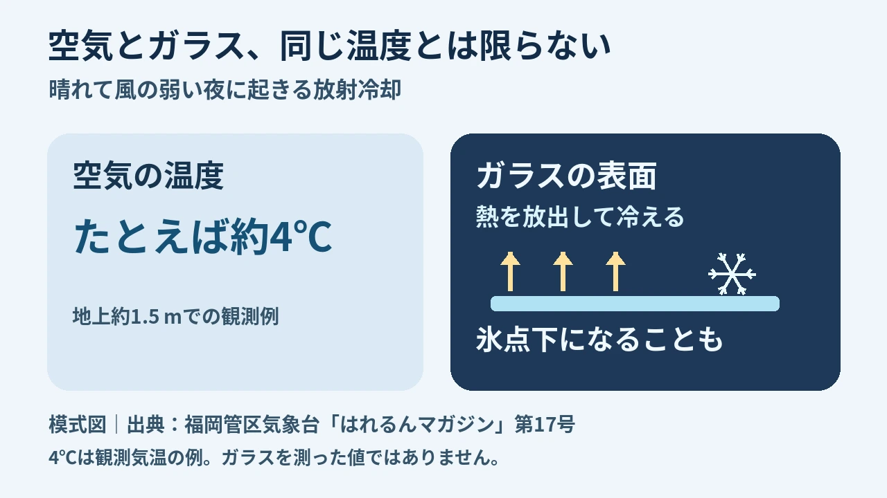

天気予報では朝の気温が4℃。それなのに、外に停めた車のフロントガラスが白くなっている。これは、**空気が氷点下にならなくても、ガラスの表面は氷点下まで冷えることがある**からです。

## 「気温」と「ガラスの温度」は別の数字

気温は空気の温度を表します。福岡管区気象台は、晴れて風が弱い夜に、地上約1.5メートルで観測した気温が約4℃でも、地面付近が0℃以下まで下がり、霜が降りることがあると説明しています。4℃はそうした夜の一例で、各家庭の駐車場や車のガラスを測った数字ではありません。

夜は日差しから熱をもらえなくなり、地面や車は赤外線として熱を出し続けます。空が晴れると雲がある夜より熱を失いやすく、風が弱いと周りの空気も混ざりにくいため、冷えが強くなります。これが放射冷却です。

*模式図。気温約4℃は福岡管区気象台「はれるんマガジン」第17号の説明例。ガラス表面の実測値ではありません。*

## 雨が降っていなくても、霜の材料はある

霜の材料は空気中の水蒸気です。外側のガラスの表面が十分に冷えると、水蒸気がその表面で直接、細かな氷の結晶になります。雨や雪が先に降っている必要はありません。

同じ4℃の予報でも毎回霜がつくとは限りません。ガラスがどこまで冷えるかに加え、空気に含まれる水蒸気の量にも左右されます。また、雨などですでに濡れていたガラスの水が凍ることもありますが、水蒸気から結晶ができる霜とは過程が違います。

## 翌朝に車を使うなら、気温だけでなく空模様も見る

予報が0℃を上回っていても、晴れて風が弱そうな夜は、朝の窓が凍っていないか確認する時間を見込めます。前夜にできる対策の一つはフロントガラス用カバーです。JAFが雪の降る菅平高原で3台を一晩比べたテストでは、カバーをかけた車はガラスが凍らず、対策なしと撥水剤を塗った車は凍りました。その一晩の比較であり、あらゆる天候で凍らないという保証ではありません。
