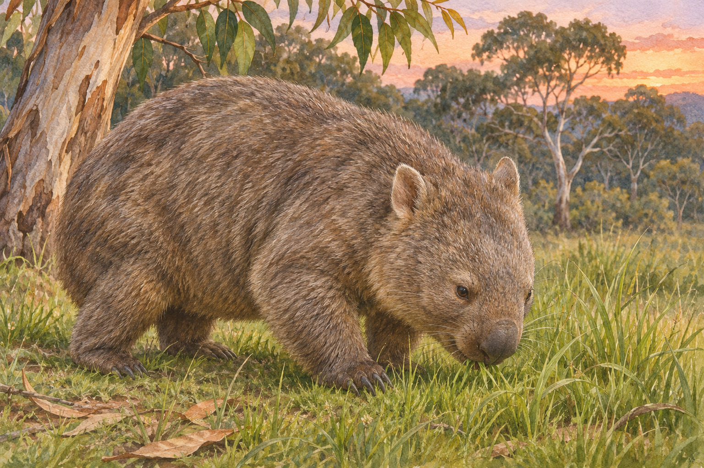
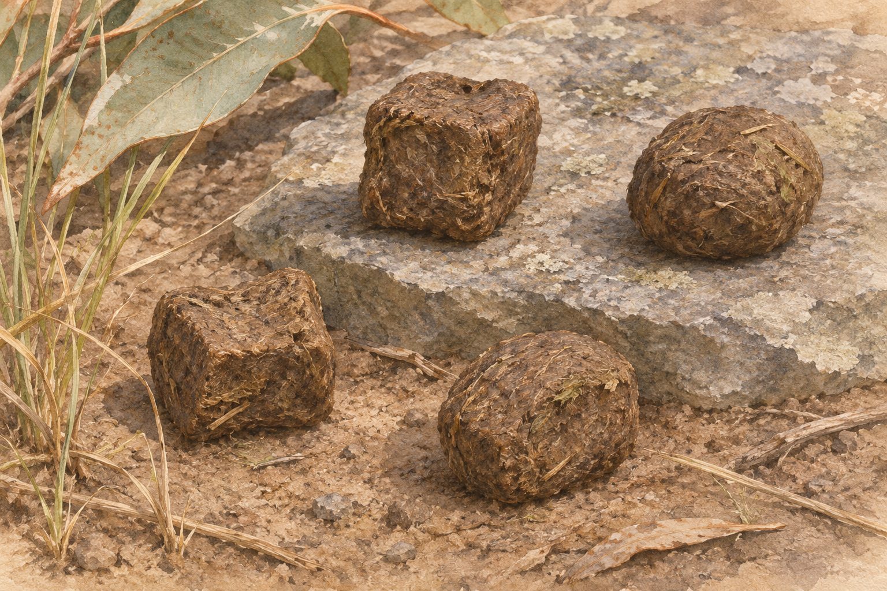

**ウォンバットのうんちが四角くなる主な理由は、腸の壁の伸びにくさが場所によって違い、収縮を繰り返すうちに角が作られるからです。角は、体の外へ出る前に腸の中でできています。**

詳しく研究されているのは、コモンウォンバットとも呼ばれる Vombatus ursinus。2021年の論文は、腸の組織の測定と数理モデルを組み合わせて、この仕組みを調べました。[角のでき方を調べた論文](https://doi.org/10.1039/D0SM01230K)

草を食べるコモンウォンバットの参考イラスト（AI生成）。

四角い物なら四角い型で作りそうなもの。それを、やわらかい腸がやっているのです。

## 腸の壁は一様なやわらかさではない

腸を輪切りにした向きで見ると、比較的硬い部分とやわらかい部分があります。研究チームは、その違いを組み込んだ輪のモデルを作り、繰り返し収縮させました。すると、四角い断面につながる角が現れました。

同じように力をかけても、場所によって動き方が違う。その積み重ねが形に影響するという説明です。ただし、モデルは実際の便の性質をすべて再現したものではありません。[2021年の研究](https://doi.org/10.1039/D0SM01230K)

## 水分によって四角さも変わる

角に丸みがあり、形にもばらつきがある便の参考イラスト（AI生成）。実測図ではありません。

タスマニア大学の研究紹介では、腸の終わりに近い部分で水分が減ることと筋肉の収縮が組み合わさり、特徴的な形ができると説明されています。水分の多い条件では四角さが弱くなる場合もあるそうです。「いつでも同じサイコロが出てくる」と考えると実物とのずれが出ます。

便は数学の図形そのままではありません。論文でも角の丸みや長さが幅より大きい形が確認されています。全てが完全な立方体という意味ではないのです。[大学の解説](https://www.utas.edu.au/about/news-and-stories/articles/2021/scientists-get-to-the-bottom-of-wombat-cubed-poo-mystery2)／[実測した形状](https://doi.org/10.1039/D0SM01230K)

## なぜ長い四角い棒にならないのか

断面が四角くなるだけなら、長い角柱になってもよさそうです。どうして短い粒に分かれるのでしょうか。

2023年の研究では、便から水分が抜ける過程で亀裂が生じ、粒の長さが決まるという仮説が検討されました。動物の便の比較、コーンスターチの乾燥実験や計算が行われています。

乾いた泥にひびが入る様子を思い浮かべると想像しやすいかもしれません。ただし、これはたとえです。論文も模型と動物のデータの違いを認めており、腸内の分裂を完全に再現したとは結論づけていません。[粒の長さを調べた論文](https://doi.org/10.1039/D2SM00359G)

## 四角いのは転がらないためなのか

「岩や丸太の近くに便を残すので、転がりにくい四角い形が役立つ」という説がよく紹介されます。けれど、その転がりにくさにも条件があります。

2021年論文の模型の予備実験では、傾斜面では四角い模型が球形より着地点の近くに残りましたが、平らな面では移動距離の関係が逆になりました。実物の便を転がした試験ではなく、四角ならどこでも動きにくいとも言えません。[予備実験](https://doi.org/10.1039/D0SM01230K)

形に利点がありそうだという話と、その利点のために進化したと分かったという話には距離があります。研究者自身も進化した理由には調べるべき点があるとしています。[大学の解説](https://www.utas.edu.au/about/news-and-stories/articles/2021/scientists-get-to-the-bottom-of-wombat-cubed-poo-mystery2)

## うんちはにおいの情報を残しているらしい

2025年の研究では、便の化学成分の組み合わせに個体ごとの違いが見つかりました。離れた場所の個体の便を既存の排便場所に加えると、そこを調べる時間が長くなる結果も得られました。

便を介したにおいの情報交換を支持する結果です。ただし、反応は2回の実験で一貫して現れたわけではなく、新しい便そのものとにおいの効果を完全には分けられていません。

対象は単独性で縄張り性を持たない動物として扱われています。「俺の土地に入るなという看板」と決めつけるより、互いの存在を知る情報源として捉えるほうが、現在の知見には合っています。[2025年の研究](https://doi.org/10.1111/jzo.70068)

## 感想

私が面白いと感じるのは、見た目以上に、やわらかい腸の性質が形を決めているところです。角のある型を用意しなくても、体の中では別のやり方が働いています。

どう作るかの先に、どこで分かれるか、何の役に立つかという疑問が続くのも好きです。四角いうんちの一言から、腸の動き、乾燥、動物どうしの情報交換までつながる。意外な見た目を入口にすると、ずいぶん遠くまで調べたくなる雑学です。
