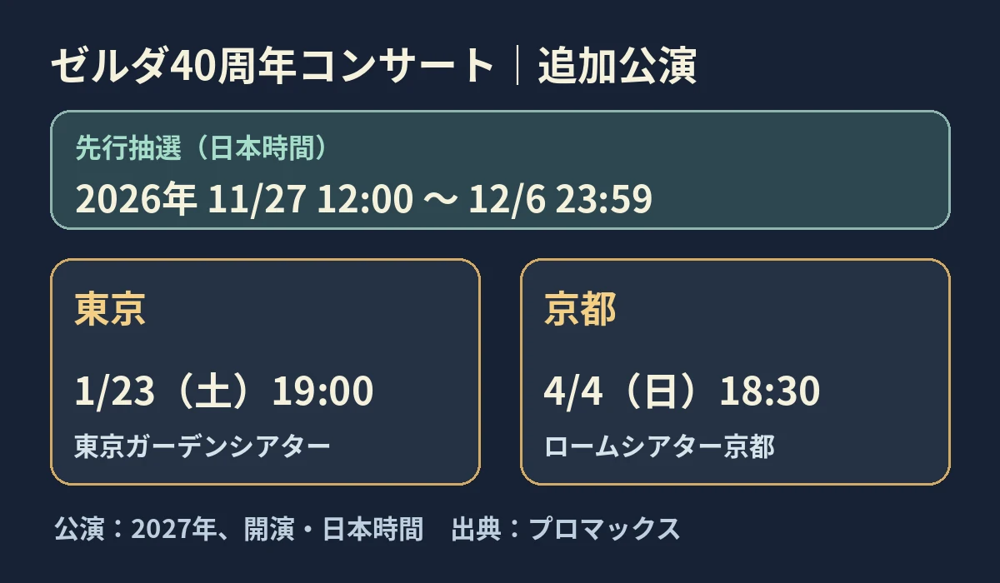

「ゼルダの伝説」の40周年コンサートが、東京から北米・欧州・オーストラリアなどへ巡ります。米シカゴ、英ロンドン、豪メルボルンではすでに完売表示の回があります。一方、日本では東京と京都で1公演ずつ増枠。国内主催者のプロマックスは、追加公演の先行抽選を**2026年11月27日12:00から12月6日23:59まで（日本時間）**受け付けると案内しています。

## 追加は、東京1月23日の夜と京都4月4日の夜

- **東京**：2027年1月23日（土）19:00開演。東京ガーデンシアター（18:00開場）。
- **京都**：2027年4月4日（日）18:30開演。ロームシアター京都 メインホール（17:30開場）。

どちらの日にも別の開演時刻があるため、都市と日付だけでなく、夜の開演時刻まで照らし合わせると間違いにくくなります。[国内主催者のチケット情報](https://www.promax.co.jp/zelda40thconcert/)では、11月18日からの「一般発売（先着）」ではなく、「追加公演 オフィシャル先行（抽選）」が今回の受付です。11月27日15時台の確認では、当サイトの確認環境からローソンチケットの申込フォームを開けませんでした。受付の最新状況は主催者の案内を確認してください。

出典：プロマックス「公演情報」「チケット情報」。開催年と抽選受付の年が異なります。

## 海外は都市だけでなく「公演回」ごとに見る

[世界公演の公式一覧](https://zelda.gameconcerts.com/)では、2027年2月22日のシカゴ、4月3日のロンドン、5月13日のメルボルンなどが完売と表示されています。いずれも現地の開催日です。同じ都市でも日時ごとに表示が分かれており、世界の全公演が完売という意味ではありません。

日本の抽選も、申し込み順で席を取る先着販売とは別です。申込前に希望する都市、開演時刻、発券条件をそろえて見ておくと、同じ日の別公演との取り違えを防げます。

関連する雑学：[オカリナを発明したのは誰？ イタリアの楽器と、それより古い土の笛](/blog/ocarina-two-origins/)
