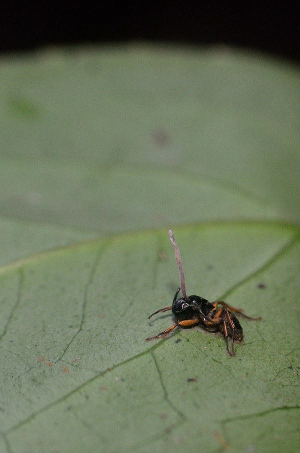
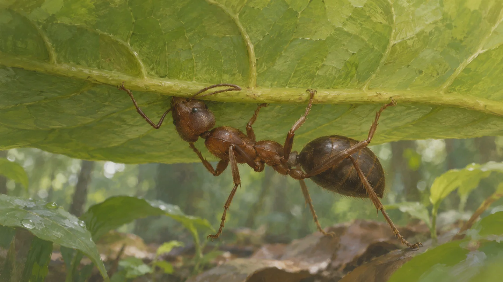

**葉をかむと、死後もアリの体が葉に残りやすくなり、寄生菌が育つ足場になると考えられています。** 「ゾンビアリ」は、特定の寄生菌によって行動が変わったアリの呼び名。映画のような話ですが、森で観察された現象です。

参考写真：ChanduBandi撮影、2023年12月2日、インドのKudremukh National Park。[原画像と説明](https://commons.wikimedia.org/wiki/File:Ophiocordyceps.jpg)／[CC BY 4.0](https://creativecommons.org/licenses/by/4.0/)。全体を縮小・JPEG再圧縮し、切り抜きや描き足しはしていません。種や菌の同定は投稿者の記載によるもので、以下のタイの研究個体ではありません。

## 森の下で、葉をかむ

2011年の論文が扱ったのは、タイ南部の森の *Camponotus leonardi* というアリと、*Ophiocordyceps unilateralis* sensu latoという寄生菌です。後者は分類の見直しを踏まえ、近縁な菌を含む広い意味で使われています。

研究者が追跡した21匹は、行列ではなく、低い植物の上を単独で不規則に歩いていました。感染はあとから確かめられています。やがて葉の裏側の葉脈をかみ、そのまま固定されて死にます。**どのアリも必ず同じ行動をする、という意味ではありません。**

葉裏の葉脈をかむ位置を描いた参考イラスト（AI生成）。観察個体やあごの正確な形の再現ではありません。

## かみついたままなのは、なぜ？

かみついたあごは、葉脈に深く入り込んでいました。また、感染して葉をかんだアリのあごの筋肉には、感染していないアリと比べて著しい萎縮が見られました。著者らは、この変化が死後も葉から落ちにくい「固定」に関わると考えています。ただし、この論文で筋肉の変化の順序や、行動を変える仕組み全体まで解明されたわけではありません。

死後には菌の柄が体外へ伸び、胞子を作ります。葉に体が残ることは、この段階を支える足場になるのです。不気味な光景ですが、単に「菌が操る」で終わらず、**歩く場所、かむ位置、体の変化**へと分けると、研究が何を確かめたのか見えてきます。
